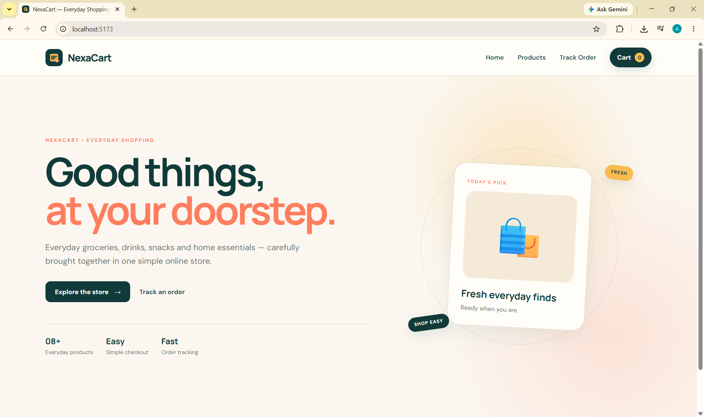
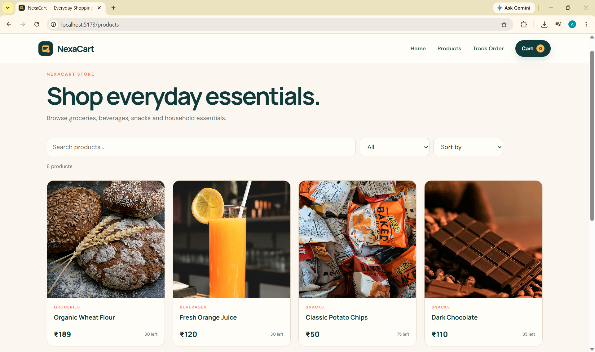
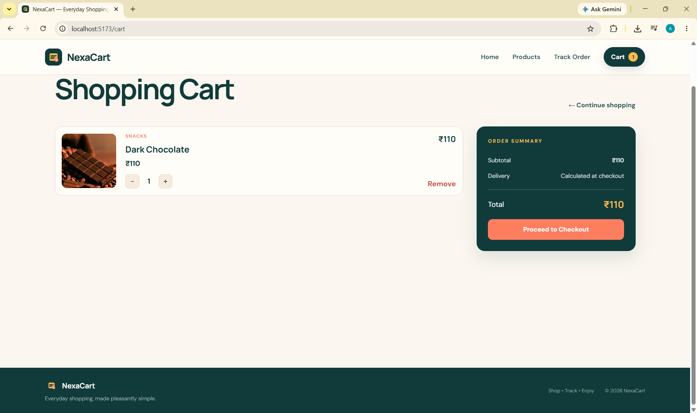
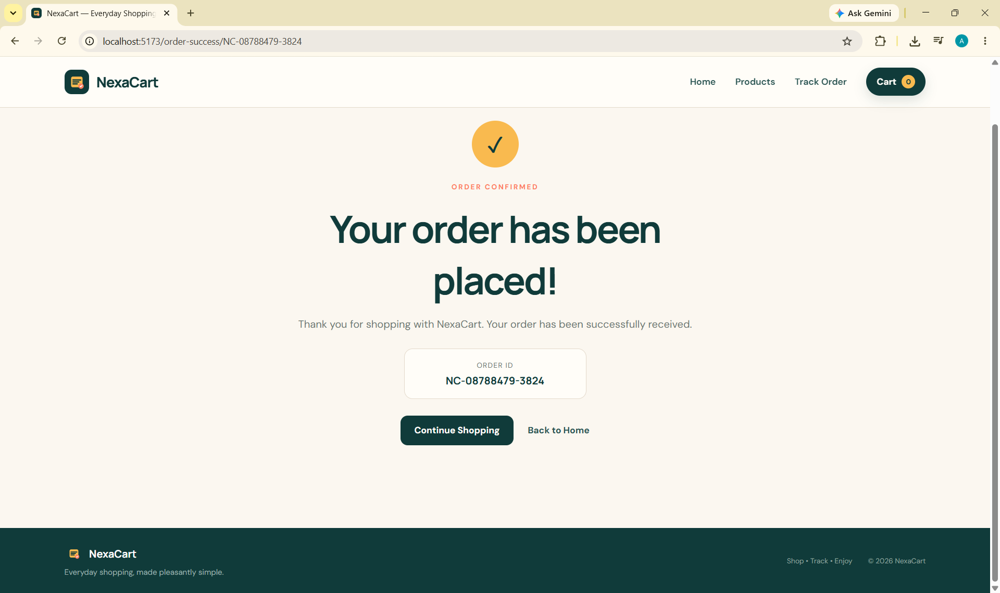
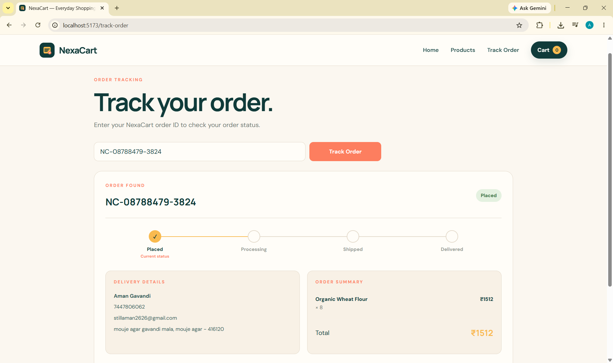

# 🛒 NexaCart — Full-Stack E-Commerce Website

NexaCart is a full-stack e-commerce web application developed as part of my **Full-Stack Web Development Internship at Prodigy InfoTech**.

The application allows customers to browse products, search and filter products, manage a shopping cart, place orders, and track their orders through a modern and responsive interface.

---

## 🚀 Live Features

- 🏠 Modern e-commerce landing page
- 🛍️ Product listing with images, prices and descriptions
- 🔎 Product search
- 🗂️ Category filtering
- ↕️ Product sorting by price and name
- 🛒 Shopping cart functionality
- ➕ Increase/decrease product quantities
- 📦 Stock-aware cart management
- 💳 Checkout and order placement
- 💾 MongoDB database integration
- 📋 Order management
- ✅ Order confirmation
- 📍 Order tracking with status timeline
- 📱 Responsive user interface

---

## 🖥️ Project Showcase

### 🏠 Home Page

The NexaCart landing page introduces the store and provides navigation to the shopping experience.



---

### 🛍️ Products Page

Customers can browse available products and use search, category filtering and sorting options.



---

### 🛒 Shopping Cart

The cart allows customers to review selected products, adjust quantities and view the total amount before checkout.



---

### ✅ Order Success

After successfully placing an order, customers receive an order confirmation with their generated order ID.



---

### 📍 Track Order

Customers can enter their order ID to view order information and track the current order status.



---

## 🛠️ Tech Stack

### Frontend

- React.js
- Vite
- JavaScript
- CSS
- React Router

### Backend

- Node.js
- Express.js

### Database

- MongoDB
- Mongoose

### Development Tools

- VS Code
- Git
- GitHub
- MongoDB Atlas
- npm

---

## 📂 Project Structure

```text
PRODIGY_WD_03/

├── client/
│   ├── public/
│   │   ├── products/
│   │   ├── favicon.svg
│   │   └── nexacart-mark.svg
│   │
│   └── src/
│       ├── components/
│       │   ├── Navbar.jsx
│       │   └── ProductCard.jsx
│       │
│       ├── context/
│       │   └── CartContext.jsx
│       │
│       ├── pages/
│       │   ├── Cart.jsx
│       │   ├── Checkout.jsx
│       │   ├── OrderSuccess.jsx
│       │   ├── ProductDetails.jsx
│       │   ├── Products.jsx
│       │   └── TrackOrder.jsx
│       │
│       ├── App.jsx
│       ├── App.css
│       ├── index.css
│       └── main.jsx
│
├── server/
│   ├── config/
│   │   └── db.js
│   │
│   ├── controllers/
│   │   ├── orderController.js
│   │   └── productController.js
│   │
│   ├── models/
│   │   ├── Order.js
│   │   └── Product.js
│   │
│   ├── routes/
│   │   ├── orderRoutes.js
│   │   └── productRoutes.js
│   │
│   ├── seedProducts.js
│   ├── server.js
│   ├── package.json
│   └── .env.example
│
├── screenshots/
│   ├── 01-home.png
│   ├── 02-products.png
│   ├── 03-cart.png
│   ├── 04-order-success.png
│   └── 05-track-order.png
│
├── .gitignore
└── README.md